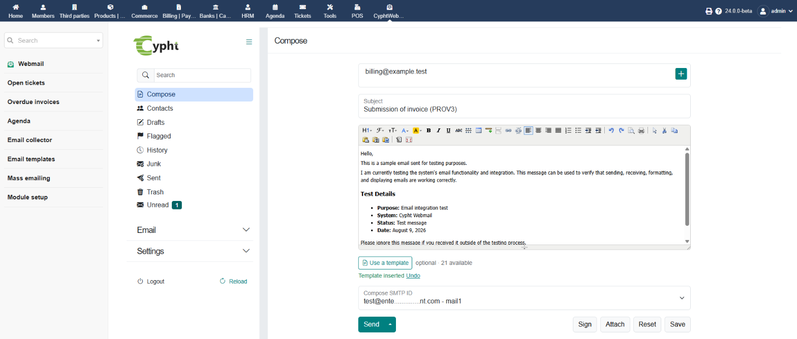

# CyphtWebmail

A Dolibarr module that puts the [Cypht](https://cypht.org) webmail inside
Dolibarr, with single sign-on, Dolibarr contacts as an address book, and mail
accounts stored in Dolibarr's own database.



- Documentation: <https://github.com/cypht-org/dolibarr-cyphtWebmail/wiki>
- Cypht: <https://cypht.org>
- Dolibarr: <https://www.dolibarr.org>

## What it does

| Feature | Notes |
|---|---|
| Embedded webmail | Cypht inside the Dolibarr interface, with Dolibarr's menu and header |
| Single sign-on | Dolibarr users reach their mail without a second login |
| Dolibarr contacts | Third parties, contacts and users come up as you type a recipient |
| [New message button](https://github.com/cypht-org/dolibarr-cyphtWebmail/wiki/New-message-button) | On third party, contact and document cards, with the address and subject filled in |
| [Email templates](https://github.com/cypht-org/dolibarr-cyphtWebmail/wiki/Writing-messages) | Dolibarr's email templates on the compose page, with an HTML editor |
| [Sender context](https://github.com/cypht-org/dolibarr-cyphtWebmail/wiki/Sender-context) | An open message shows the sender's company and their open proposals, orders, invoices, tickets and projects |
| [Home page box](https://github.com/cypht-org/dolibarr-cyphtWebmail/wiki/Home-page-box) | Unread, from-contacts and flagged messages on the Dolibarr home page |
| Language and theme | The webmail follows the user's Dolibarr language and light or dark mode |
| Accounts in the database | Mail accounts and settings live in Dolibarr's database, with mailbox passwords encrypted |
| Deep links | The browser URL follows the webmail page, so reload and bookmarks work |

## Requirements

- Dolibarr 19 or later (developed against 24.0)
- PHP 8.1 or later, with `curl`, `openssl`, `mbstring`, `dom` and `PDO`
- MySQL, MariaDB or PostgreSQL, the database Dolibarr already uses

## Install

1. Download `module_cyphtwebmail-x.y.z.zip` from the [releases](https://github.com/cypht-org/dolibarr-cyphtWebmail/releases).
2. In Dolibarr, **Home** > **Setup** > **Modules/Applications** > **Deploy/install external app/module**, upload the zip. Or unzip it into `htdocs/custom/`.
3. Switch **CyphtWebmail** on in the module list.

The zip is already built. Details, upgrading and installing from git:
[Installation and upgrading](https://github.com/cypht-org/dolibarr-cyphtWebmail/wiki/Installation-and-upgrading).

## Documentation

- **Users**: [Getting started](https://github.com/cypht-org/dolibarr-cyphtWebmail/wiki/Getting-started), then the other pages of the [wiki](https://github.com/cypht-org/dolibarr-cyphtWebmail/wiki).
- **Administrators**: [Configuration](https://github.com/cypht-org/dolibarr-cyphtWebmail/wiki/Configuration) and [Troubleshooting](https://github.com/cypht-org/dolibarr-cyphtWebmail/wiki/Troubleshooting).
- **Developers**: [CONTRIBUTING.md](CONTRIBUTING.md), for the project layout, how it works, building and releasing.

## Where data is stored

| What | Where | Notes |
|---|---|---|
| Mail accounts and settings | `llx_cyphtwebmail_userconfig` | one row per user, removed with the user, follows a login change |
| Home page counts | `llx_cyphtwebmail_mailstatus` | one row per user, counts only, no subjects or senders |
| Secrets | `llx_const` | `CYPHTWEBMAIL_SSO_SECRET`, `CYPHTWEBMAIL_CONFIG_SECRET` |
| Menu entries | `llx_menu` | written when the module is switched on |
| Sessions | `documents/cyphtwebmail/sso_sessions/` | cleaned up over time |
| Attachments being written | `documents/cyphtwebmail/attachments/` | |
| Built app | `public/` | made by the build, safe to delete |
| Cypht itself | `vendor/jason-munro/cypht/` | managed by Composer, never edit |

The `config` column is plain JSON, with only the `pass` values encrypted and
marked `enc:v1:`:

```sql
SELECT u.login, c.config
FROM llx_cyphtwebmail_userconfig c
JOIN llx_user u ON u.rowid = c.fk_user;
```

Mail itself is never stored in Dolibarr, it stays on the mail server.

## Configuration reference

Most of these are on the module setup page, see
[Configuration](https://github.com/cypht-org/dolibarr-cyphtWebmail/wiki/Configuration).
The others are set in **Home** > **Setup** > **Other**.

| Constant | Default | Purpose |
|---|---|---|
| `CYPHTWEBMAIL_SSO_SECRET` | generated | signs SSO and bridge tokens |
| `CYPHTWEBMAIL_CONFIG_SECRET` | generated | encrypts stored mailbox passwords |
| `CYPHTWEBMAIL_SESSION_TTL` | `604800` | session lifetime, seconds |
| `CYPHTWEBMAIL_SESSION_GC_DIVISOR` | `200` | 1 sign-in in N cleans up old sessions |
| `CYPHTWEBMAIL_SESSION_DEBUG` | `false` | verbose session log, leave off |
| `CYPHTWEBMAIL_CONTACTS_INCLUDE_USERS` | `true` | list Dolibarr users in the address book |
| `CYPHTWEBMAIL_CONTACTS_TTL` | `300` | contact cache lifetime, seconds |
| `CYPHTWEBMAIL_CONTACTS_MAX` | `2000` | maximum contacts loaded |
| `CYPHTWEBMAIL_CONTACTS_TIMEOUT` | `5` | bridge HTTP timeout, seconds |
| `CYPHTWEBMAIL_CONTACTS_INSECURE` | `false` | skip TLS checks on bridge calls (self-signed certificates) |
| `CYPHTWEBMAIL_BRIDGE_URL` | auto | set when Dolibarr can't reach itself by its public URL |
| `CYPHTWEBMAIL_DASHBOARD` | `true` | show the Webmail box on the home page |
| `CYPHTWEBMAIL_DELAY_UNREAD` | `2` | days after which unread messages from contacts are late, `0` for never |
| `CYPHTWEBMAIL_CONTEXT_BLOCKS` | `propal,order,invoice,ticket,project` | record types shown beside the sender, `none` for none |
| `CYPHTWEBMAIL_CONTEXT_INVOICES` | `unpaid` | `unpaid`, or `open` for all validated invoices |
| `CYPHTWEBMAIL_CONTEXT_ROWS` | `3` | records listed per type beside the sender |
| `CYPHTWEBMAIL_LANG_MODE` | `follow` | `follow` the Dolibarr language, or `user` to let each user choose |
| `CYPHTWEBMAIL_THEME_MODE` | `follow` | `follow` Dolibarr's light or dark mode, or `user` to let each user choose |
| `CYPHTWEBMAIL_COMPOSE_MODE` | `html` | `html` for the HTML editor, or `user` to let each user choose |
| `CYPHTWEBMAIL_ENABLE_BUILD` | `0` | show the Generate button when Dolibarr runs in production mode |

## Security

- `CYPHTWEBMAIL_CONFIG_SECRET` encrypts the stored mailbox passwords. Changing
  it makes them unreadable, users then have to enter them again.
- `CYPHTWEBMAIL_SSO_SECRET` signs sign-in and bridge tokens. Changing it ends
  the open sessions.
- Leave `CYPHTWEBMAIL_SESSION_DEBUG` off in production.
- Release zips hold no secrets, only build defaults. Each installation creates
  its own.

## License

This module is free software under the GNU Lesser General Public License,
version 2.1 or, at your option, any later version, the same license as Cypht.
The full text is in [LICENSE](LICENSE).

The module descriptor, `core/modules/modcyphtWebmail.class.php`, is based on
Dolibarr's module template and stays under the GNU General Public License,
version 3 or later.
